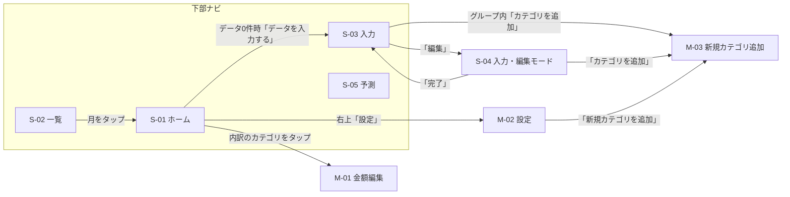

# Money Flow（支出管理アプリ）引き継ぎ資料

- 作成日: 2026-11-08（最終更新: 2026-11-08）
- 対象: `master` 最新コミット `ec85735`（2026-04-11）＋ まだコミットしていない変更（§0.1）
- 調べ方: ソースコードを全て読んで整理した。**アプリを起動しての動作確認はしていない**。「要確認」と書いた箇所は、コードからは断定できない点。
- 読み方: まず §0 で「今どうなっているか」「次に何をするか」をつかみ、§1 以降で仕様を確認する。

---

## 0. 引き継ぎの要点（最初に読む）

### 0.1 今の状態

- 本番: Vercel で公開中。`master` に push すると自動でデプロイされる。
- リポジトリ: https://github.com/TsubakiMan/expense-tracker（ブランチ `master`。最後の push は 2026-04-11 の `ec85735`）
- **まだコミットしていない変更がある**（2026-11-08 の引き継ぎ準備で行ったもの）:

| ファイル | 変更内容 |
|---|---|
| `HANDOFF.md` | 新規。この資料 |
| `README.md` | GAS 時代の手順を Supabase 構成に書き直した。テーブル定義の推定版、開発時の注意、既知の課題（主なもの）、変更履歴を追加 |
| `.env.local.example` | 使う環境変数を `NEXT_PUBLIC_SUPABASE_URL` / `NEXT_PUBLIC_SUPABASE_ANON_KEY` に変更 |
| `lib/api.js` | `updateRow` で、追加カテゴリの値（`custom_data`）を DB の値と合わせてから保存するように修正（§8 課題2） |

- `lib/api.js` の修正は、Supabase の代わりにモックをつないだテスト（6件）で、修正前は失敗・修正後は成功することを確認した。**実際の Supabase と画面ではまだ確認していない**。このテストはリポジトリには入れていない。
- push すると `lib/api.js` の修正がそのまま本番に出る。

### 0.2 開発するときの注意

- **ローカルの `.env.local` は本番と同じ Supabase につながっている可能性が高い**（Supabase のプロジェクトは1つと思われる。**要確認**）。その場合、ローカルで保存すると本番のデータが書き換わる。データを変える確認は、テスト用の Supabase プロジェクトを作ってから行うのが安全。
- `.env.local` には接続情報が入っている。コミットしない（`.gitignore` 済み）。
- 画面とロジックのほとんどは `app/page.js` 1ファイル。どこに何があるかは §9 の行番号を目安にする。
- テストの仕組みがない。計算まわり（§6）を変えたら、ホーム・一覧・予測の数字が意図どおりか画面で確認する。

### 0.3 持ち主に確認が必要なこと

| # | 確認すること | 関係する課題 |
|---|---|---|
| 1 | 新しい月のデータを、今はどうやって追加しているか（画面から追加できないため） | §8 課題1 |
| 2 | Supabase の RLS（アクセス制御）がどう設定されているか | §8 課題13 |
| 3 | 本番のテーブル定義（型・制約）が README の推定版と同じか | §8 課題14 |
| 4 | ローカルと本番が同じ Supabase プロジェクトを使っているか | §0.2 |
| 5 | 修正前にホームの金額編集で追加カテゴリを保存したことがあるか（あれば、その月のほかの追加カテゴリの値が消えている可能性がある） | §8 課題2 |

### 0.4 次にやること（おすすめの順番）

1. 今のコミットしていない変更をコミットして push するか決める。
2. `lib/api.js` の修正を実際に確かめる: 追加カテゴリを2つ以上持つ月で、ホームの金額編集から1つを保存 → 再読み込み → ほかの追加カテゴリの値が残っているか。
3. §0.3 の確認事項を持ち主に聞く。
4. 新しい月を画面から追加できるようにする（§8 課題1）。入力画面の対象月をホームの表示月とそろえる（課題3）。
5. 金額編集で補正後の金額が保存される問題を直す（課題4）。
6. 予測・補正の計算の食い違いを、仕様として決めてそろえる（課題5・6・8）。
7. 追加カテゴリのキー番号を使い回さないようにする（課題7）。
8. 土台を整える: テストの導入、`app/page.js` の分割（課題16・18）。

---

## 1. サービス概要

| 項目 | 内容 |
|---|---|
| アプリ名 | Money Flow（`manifest.json` / `layout.js`） |
| 用途 | 個人の**月単位**の収支管理と、将来の残高予測・シミュレーション |
| 利用者 | 1人（ログイン機能なし。データは1人分しか持たない） |
| 利用環境 | スマホ前提（画面幅は最大430pxで固定）。PWAとしてホーム画面に追加できる |
| 記録の単位 | 1か月 = 1行。カテゴリごとの月額、銀行残高2口座（北洋銀行・楽天銀行）、備考 |

**できること（要約）**
1. 月ごとの収入・支出をカテゴリ別に入力する
2. 月の収支・内訳（ドーナツグラフ・グループ別の棒）・口座残高を見る
3. データがない月は直近3か月の平均から「予測」を表示する
4. カテゴリの名前変更・並び替え・非表示・追加・削除、グループ分けをする
5. カテゴリごとに「いつ終わるか」「毎年何月だけ発生するか」「季節の上乗せ額」「昇給」「ボーナス」を設定し、予測に反映する
6. 月収・月支出を変えてみて、12か月先までの残高をシミュレーションする
7. 設定を Supabase に保存し、複数の端末で共有する

---

## 2. 技術構成

| 層 | 使用技術 |
|---|---|
| フロントエンド | Next.js 14（App Router）/ React 18 / JavaScript（TypeScriptなし） |
| グラフ | Chart.js 4 + react-chartjs-2 |
| スタイル | 素のCSS（`app/globals.css`、約2,170行）。Tailwind等は不使用。ライトテーマのみ |
| データベース | **Supabase**（`@supabase/supabase-js` v2。ブラウザから anon key で直接読み書き） |
| ホスティング | Vercel（`.vercel/` あり。`git push` で自動デプロイの運用） |
| PWA | `public/manifest.json` とアイコンのみ。Service Worker はないのでオフラインでは動かない |
| テスト / Lint | なし |

> 補足: 以前は「GAS（Google Apps Script）+ スプレッドシート」構成で、コミット `ea31242` で Supabase に移行した。`gas/Code.gs` はその頃の旧バックエンドで、今は使われていない。README.md と `.env.local.example` は 2026-11-08 に Supabase 構成に書き直した。

### 2.1 ファイル構成

```
expense-tracker/
├── app/
│   ├── layout.js        ルートレイアウト（メタ情報・PWA設定）
│   ├── page.js          ★アプリ本体。全画面・全ロジックがこの1ファイル（2,732行）
│   └── globals.css      全スタイル
├── components/
│   └── Charts.js        グラフ3種（ドーナツ / 残高予測の折れ線 / 収支の棒）
├── lib/
│   ├── api.js           Supabase との読み書き（キー名の変換を含む）
│   ├── supabase.js      Supabase クライアントの生成
│   └── utils.js         カテゴリ定義・金額の表示形式・合計の計算
├── gas/Code.gs          旧 GAS バックエンド（未使用）
├── public/              manifest.json、アイコン（192 / 512）
├── .env.local.example   環境変数のひな形
├── README.md            セットアップ手順（Supabase のテーブル定義の推定版を含む）
└── .claude/launch.json  開発サーバー起動設定（npm run dev, port 3000）
```

### 2.2 環境変数（実際に使われているもの）

| 変数名 | 用途 |
|---|---|
| `NEXT_PUBLIC_SUPABASE_URL` | Supabase のプロジェクトURL |
| `NEXT_PUBLIC_SUPABASE_ANON_KEY` | Supabase の anon key |

ひな形は `.env.local.example`。

### 2.3 起動

```bash
npm install
npm run dev   # http://localhost:3000
```

---

## 3. 画面構成

### 3.1 画面一覧

画面遷移は URL を変えずに、`page.js` 内の状態（`view`）で切り替える1ページ構成。ブラウザの「戻る」は History API で対応済み（開いているモーダルから順に閉じ、なければ前のタブへ戻る）。

| ID | 画面名 | 種類 | 開き方 | コンポーネント |
|---|---|---|---|---|
| S-01 | ホーム | タブ | 下部ナビ「ホーム」（起動時の画面） | `HomeView` |
| S-02 | 一覧 | タブ | 下部ナビ「一覧」 | `HistoryView` |
| S-03 | 入力（通常モード） | タブ | 下部ナビ「入力」 | `InputView` |
| S-04 | 入力（編集モード） | タブ内の切替 | 入力画面の「編集」ボタン | `InputView`（`editMode`） |
| S-05 | 予測 | タブ | 下部ナビ「予測」 | `ForecastView` |
| M-01 | 金額編集 | モーダル | ホームの内訳でカテゴリをタップ | `EditModal` |
| M-02 | 設定 | モーダル | ホーム右上「設定」 | `SettingsModal` |
| M-03 | 新規カテゴリ追加 | モーダル | 入力（通常/編集）・設定の「カテゴリを追加」 | `NewCategoryModal` |
| — | 読み込み中 | 全画面 | 起動時 | `Home` 内 |
| — | デモモード | 帯表示 | データ取得に失敗したとき | `Home` 内 |

**共通パーツ**
- ヘッダー: 「Money Flow」ロゴ ＋ 右側に画面ごとのボタン
- 下部ナビ（固定）: ホーム / 一覧 / 入力 / 予測
- トースト: 画面下に2.5秒表示（「保存しました」「追加しました」「同期エラー: …」）
- 振動フィードバック: タップ・ドラッグ・保存などで端末を振動させる（`navigator.vibrate`。iPhone の Safari は非対応）

### 3.2 画面遷移図



### 3.3 各画面の詳細

#### S-01 ホーム

```
[ヘッダー]  Money Flow                          [設定]
[月表示]    2026年4月   (予測バッジ ※データがない月のみ)
[‹] [›]     画面の左右端に固定した前月/翌月ボタン（高さ55%の位置）
[予測の帯]  「予測データ（直近3ヶ月の平均から算出）」※データがない月のみ
[ヒーロー]  Monthly Balance（予測時は Projected Balance）
            +¥12,345   ← 収支。プラスは緑、マイナスは赤
            ● 収入合計  ● 支出合計
[口座カード] 北洋銀行 ¥xxx | 楽天銀行 ¥xxx
[Income]    収入カテゴリ一覧（0円は非表示。全部0円なら「収入データなし」）
[Expenses]  ドーナツグラフ（グループ単位＋未分類カテゴリ）。中央に支出合計、下に凡例
[Breakdown] グループごとのカード：色・名前・件数・合計・棒グラフ
              └ タップで開閉 → 中のカテゴリをタップで M-01 金額編集
            未分類カテゴリは個別の棒で表示（タップで M-01）
            支出が全部0円なら「支出データなし」
[Notes]     備考（入力がある場合のみ）
```

- 月の移動に上限・下限はない。データがない月は「予測」として表示し、その間は金額をタップしても編集できない。
- データが1件もないときは「データがありません」と「データを入力する」ボタン（→入力画面）を出す。
- 表示する金額には、カテゴリのスケジュール設定（§6.2）による補正が**実績データにもかかる**。

#### S-02 一覧

```
[ヘッダー]  Money Flow
[Monthly History]
  2026年4月                         +¥12,345
  ¥収入合計 / ¥支出合計
  2026年3月                         -¥3,000
  …（新しい月が上）
```
- 行をタップ → その月をホームで表示し、入力画面の対象月にもする。
- 一覧の金額は**生データ**（スケジュール補正なし）。

#### S-03 入力（通常モード）

```
[ヘッダー]  Money Flow                 [✓保存] [✎編集]
            2026年4月   ← 入力する対象の月（変更はできない）
[Income]    収入カテゴリごとの数値入力 ＋ スケジュールのバッジ
[Expenses]  グループごとのカード（開閉可・グループ合計を表示）
              └ カテゴリごとの数値入力 ＋ バッジ
              └ 「+ カテゴリを追加」→ M-03（そのグループを選んだ状態で開く）
            未分類カテゴリのカード（見出しなし）
[Balance & Notes]  北洋銀行 / 楽天銀行 / 備考（複数行）
[保存する]
```
- 数値入力は空欄にでき（0扱い）、フォーカスすると全選択される（`NumInput`）。
- スケジュールのバッジ: 終了月「〜2026/3」（過ぎていればグレー）、発生期間「6月〜9月」、季節の上乗せ「+¥3,000 12月〜2月」、金額変更「+¥10,000 2026/4〜」。
- 対象の月がすでにあれば上書き保存、なければ新規追加。ただし §8 の課題1を参照。

#### S-04 入力（編集モード）

カテゴリとグループの構成を、入力画面の上でそのまま編集するモード。

```
[ヘッダー]  Money Flow                          [✓完了]
[Income]    ⠿ [カテゴリ名を入力] [×]     ← ⠿でドラッグして並び替え、×で削除
              └ [📅スケジュール ▾] → スケジュール設定欄（§6.2）
            [+ カテゴリを追加] → M-03
[Expenses]  グループカード: [グループ名を入力] [🗑削除（確認あり）] [▾]
              ⠿ [カテゴリ名] [⇅グループ間の移動] [×]
                └ [📅スケジュール ▾]
              空のとき「ここにカテゴリをドロップ」
              [+ カテゴリを追加] → M-03（このグループで）
            未分類カード（ドロップ先にもなる）
            [+ カテゴリを追加（未分類）]
[新しいグループを作成]  [グループ名（例：サブスク、交際費…）] → [「○○」を追加]
```

- ⇅ を押したまま別のグループへ動かすと、そのカテゴリをグループ間で移動できる（移動中は「『○○』をドラッグ中 — 移動先のグループへドロップ」と表示）。
- × は、初期カテゴリなら「非表示」、自分で追加したカテゴリなら「削除」になる。

#### S-05 予測

```
[ヘッダー]  Money Flow
[Simulation]
  月収 (Income)         [戻す]       [-] [ 220000 ] [+]   ← ±1万円ずつ
    ベース ¥220,000 → ¥230,000 (+¥10,000)   ※変えたときだけ表示
  月間支出 (Expense)    [戻す]       [-] [ 150000 ] [+]
  [すべてリセット]（変えたときだけ表示）
  月間収支 | 年間貯蓄 | 貯蓄率 | 12ヶ月後残高
[Income Changes]
  昇給予定（初期の収入カテゴリ＝給与・副収入・その他収入）
    カテゴリ名  (+¥10,000 2026/4〜 バッジ)
    現在の金額: ¥xxx（直近3か月の平均）
    変更後の金額: [-1万] [入力] [+1万]
    適用開始月: [最新データの翌月から24か月分の選択肢]
  ボーナス予定（自分で追加した収入カテゴリ）
    金額 [入力]   支給予定月 [選択]
[Balance Projection]  12か月分の残高の折れ線（変えたときは「現在ペース」を点線で重ねる）
[Monthly Detail]      月 / 収入 / 支出 / 収支 / 残高 の表（12か月）
[Surplus History]     これまでの月ごとの収支の棒グラフ（プラス緑・マイナス赤。2か月以上あるとき）
```
- 月収・月支出の入力値は**保存されない**（画面を離れると元に戻る）。昇給・ボーナスの設定は保存される。

#### M-01 金額編集

- タイトル: カテゴリ名 / 入力欄「金額」/ [キャンセル] [保存]
- 保存するとそのカテゴリ1項目だけを更新する。

#### M-02 設定（2タブ）

**カテゴリタブ**（「名称変更・並び替え・非表示の管理ができます」）
- Income: ⠿並び替え / 名前の変更 / ×（非表示・削除）
  - 「カテゴリを追加 (n)」→ 非表示にした初期カテゴリをチップから選んで再表示
  - 「新規カテゴリを追加」→ M-03
- Expenses: グループごとに開閉できる区切り（件数を表示）
  - その中で並び替え・名前の変更・×
  - グループごとの「カテゴリを追加」→ 非表示のカテゴリをこのグループに入れて再表示
  - 「未分類」の区切り
  - 「新規カテゴリを追加」→ M-03
- 「デフォルトに戻す」→ カテゴリの並び順と表示状態を初期に戻す（追加したカテゴリは残る）

**グループタブ**（「支出カテゴリをグループにまとめます。ドラッグで並び替えできます。」）
- グループのカード: ⠿並び替え / 名前をタップして変更 / 🗑削除（**確認なし**）
- 全支出カテゴリのチップ: 押すとこのグループに入れる・外す。別グループに入っているものは押せない
- 「新しいグループ名…」＋[追加]
- 「デフォルトに戻す」→ グループを初期の5つに戻す

[完了] で閉じる。

#### M-03 新規カテゴリ追加

- 「n カテゴリ使用中」と表示
- タブ（非表示の初期カテゴリがあるときだけ表示）: **新規作成** / **非表示から復元**
- 新規作成: カテゴリ名（例: 医療費, 教育費...）＋ グループ（任意。支出のときだけ）→ [追加する]
- 非表示から復元: 復元するカテゴリをチップで選ぶ ＋ 表示名（変更可）＋ グループ（任意）→ [復元する]

---

## 4. 機能一覧

| ID | 区分 | 機能 | 画面 | 補足 |
|---|---|---|---|---|
| F-01 | 表示 | 月の収支（収入合計・支出合計・差額）の表示 | S-01 | プラスは緑、マイナスは赤 |
| F-02 | 表示 | 月の切り替え（前月/翌月） | S-01 | 画面端に固定のボタン。範囲の制限なし |
| F-03 | 表示 | データがない月の予測表示 | S-01 | 直近3件の平均＋スケジュール補正。残高も推計 |
| F-04 | 表示 | 口座残高の表示（北洋銀行・楽天銀行） | S-01 | 口座は2つで固定 |
| F-05 | 表示 | 収入の内訳 | S-01 | 0円のカテゴリは隠す |
| F-06 | 表示 | 支出のドーナツグラフ | S-01 | グループ単位＋未分類 |
| F-07 | 表示 | グループ別の内訳（開閉・棒グラフ） | S-01 | |
| F-08 | 表示 | 備考の表示 | S-01 | |
| F-09 | 表示 | データ0件のときの案内 | S-01 | 入力画面へのボタン |
| F-10 | 表示 | 月ごとの一覧（収入/支出/収支） | S-02 | 新しい月が上 |
| F-11 | 操作 | 一覧から月を選んでホームで表示 | S-02 | 入力画面の対象月も変わる |
| F-12 | 入力 | 月のデータ入力（収入・支出・残高・備考） | S-03 | 先に画面へ反映し、裏で保存する |
| F-13 | 入力 | 項目を1つだけ編集 | M-01 | ホームの内訳から |
| F-14 | 入力 | 新しい月の追加 | S-03 | **データが0件のときしか動かない**（§8 課題1） |
| F-15 | カテゴリ | 名前の変更 | S-04 / M-02 | 初期カテゴリも変えられる |
| F-16 | カテゴリ | 並び替え（ドラッグ） | S-04 / M-02 | タッチ・マウス両対応 |
| F-17 | カテゴリ | 非表示・再表示（初期カテゴリ） | S-04 / M-02 / M-03 | |
| F-18 | カテゴリ | 新しいカテゴリの作成 | M-03 | 収入・支出とも。上限チェックなし |
| F-19 | カテゴリ | 追加したカテゴリの削除 | S-04 / M-02 | 設定から消えるが、DBの値は残る |
| F-20 | カテゴリ | 初期の並び・表示に戻す | M-02 | |
| F-21 | グループ | グループの作成・名前変更・削除 | S-04 / M-02 | |
| F-22 | グループ | グループの並び替え | M-02 | |
| F-23 | グループ | カテゴリのグループ割り当て | S-04（ドラッグ）/ M-02（チップ）/ M-03 | 1カテゴリは1グループまで |
| F-24 | グループ | 初期グループに戻す | M-02 | |
| F-25 | スケジュール | 支払い（収入）終了月 | S-04 | その月より後は0円扱い |
| F-26 | スケジュール | 毎年の発生期間（例: 6〜9月） | S-04 | 期間外の月は0円扱い。年をまたぐ指定（11〜2月）も可 |
| F-27 | スケジュール | 季節の上乗せ額＋期間 | S-04 | 期間内の月は金額を足す |
| F-28 | スケジュール | 金額変更予定（昇給など） | S-04（収入）/ S-05 | 適用開始月から差額を足す |
| F-29 | スケジュール | ボーナス予定（1回だけ） | S-05 | 自分で追加した収入カテゴリが対象 |
| F-30 | スケジュール | バッジ表示 | S-03 | |
| F-31 | 予測 | 月収・月支出のシミュレーション | S-05 | ±1万円ボタン、直接入力、戻す |
| F-32 | 予測 | 指標（月間収支・年間貯蓄・貯蓄率・12か月後の残高） | S-05 | |
| F-33 | 予測 | 12か月の残高予測グラフ | S-05 | 調整後と現在ペースを比較 |
| F-34 | 予測 | 月ごとの予測表 | S-05 | |
| F-35 | 予測 | これまでの収支の棒グラフ | S-05 | |
| F-36 | 同期 | 設定の端末間共有 | 全体 | localStorage と Supabase の両方に保存 |
| F-37 | 同期 | 保存に失敗したときのエラー表示と読み直し | 全体 | トースト「同期エラー」 |
| F-38 | 共通 | デモモード | 全体 | 取得失敗時にサンプル6か月分を表示。保存はしない（環境変数が空のときは動かない。§8 課題12） |
| F-39 | 共通 | ブラウザの「戻る」への対応 | 全体 | モーダル → 画面の順に戻る |
| F-40 | 共通 | 振動フィードバック | 全体 | 6種類（light / medium / heavy / success / error / tick） |
| F-41 | 共通 | PWA（ホーム画面に追加） | — | オフラインでは動かない |
| F-42 | API | 月データの削除 | — | **API（`deleteRow`）はあるが画面がない** |

---

## 5. データモデル

### 5.1 Supabase のテーブル

> 本番のスキーマ定義（SQL・マイグレーション）はリポジトリにない。以下は `lib/api.js` から読み取った内容。これを元にした `CREATE TABLE` 文を README.md に載せたが、本番の型・制約・RLS と同じかは Supabase の管理画面で**要確認**。

**`monthly_data`**（1行 = 1か月）

| DBのカラム | アプリでの名前 | 意味 |
|---|---|---|
| `id` | `rowNum` | 主キー。アプリでは行の識別に使う |
| `created_at` | — | 読み込み時は無視 |
| `date` | `date` | 年月。アプリは `"YYYY-MM"` の文字列として比べている（text 型と思われる） |
| `salary` / `side_income` / `other_income` | `salary` / `sideIncome` / `otherIncome` | 収入：給与 / 副収入 / その他収入 |
| `rent` `food` `electric` `gas` `water` `phone` `subscription` `transport` `daily` `insurance` `loan` `hobby` `beauty` | 同名 | 支出：家賃 / 食費 / 電気 / ガス / 水道 / 通信費 / サブスク / 交通費 / 日用品 / 保険 / ローン / 趣味・娯楽 / 美容 |
| `other_expense` / `extra_expense` | `otherExpense` / `extraExpense` | 支出：その他 / 臨時支出 |
| `balance_hokyo` / `balance_rakuten` | `balanceHokyo` / `balanceRakuten` | 月末の口座残高：北洋銀行 / 楽天銀行 |
| `notes` | `notes` | 備考 |
| `custom_data` | （展開して各キー） | 追加したカテゴリの金額。JSON `{"cx_1": 3000, "ci_1": 50000}` |

- 並び順は `date` の昇順で取得。
- アプリでの名前とDBのカラム名の変換は `lib/api.js` の `TO_DB` / `TO_APP` で行う。

**`settings`**（設定の保存先。key-value 形式）

| カラム | 内容 |
|---|---|
| `key` | 設定名（unique。upsert の衝突判定に使う） |
| `value` | JSON |
| `updated_at` | 保存時刻 |

### 5.2 `settings` に入る値

| key | 形 | 意味 |
|---|---|---|
| `customLabels` | `{ [カテゴリキー]: 表示名 }` | カテゴリ名の変更内容 |
| `categoryConfig` | `{ income: string[], expense: string[] }` | **表示する**カテゴリとその並び順（入っていなければ非表示） |
| `expenseGroups` | `[{ id, name, keys: string[] }]` | 支出のグループ。`id` は初期分が `housing` など、追加分は `g_<時刻>` |
| `customCategories` | `[{ key, label, type: 'income'｜'expense' }]` | 自分で追加したカテゴリ |
| `categorySchedule` | `{ [カテゴリキー]: Schedule }` | スケジュール設定（下表） |
| `categoryEndDates` | `{ [キー]: 'YYYY-MM' }` | 旧形式。読み込み時に `categorySchedule.endDate` へ移す |

**Schedule の中身**

| フィールド | 形 | 意味 | 設定する画面 |
|---|---|---|---|
| `endDate` | `'YYYY-MM'` | この月より後は0円 | S-04 |
| `seasonStart` / `seasonEnd` | 1〜12 | 毎年この期間だけ発生する（年またぎ可） | S-04 |
| `extraAmount` | 数値 | 上乗せする額 | S-04 |
| `extraStart` / `extraEnd` | 1〜12 | 上乗せする期間（年またぎ可） | S-04 |
| `currentAmount` | 数値 | 変更前の金額（差額の計算用） | S-04 / S-05（自動で入る） |
| `futureAmount` | 数値 | 変更後の金額 | S-04 / S-05 |
| `futureStart` | `'YYYY-MM'` | 変更後の金額を使い始める月 | S-04 / S-05 |
| `bonusAmount` | 数値 | ボーナスの額 | S-05 |
| `bonusMonth` | `'YYYY-MM'` | ボーナスが出る月（その月だけ） | S-05 |

### 5.3 カテゴリのキー

| 種類 | キー | 備考 |
|---|---|---|
| 初期の収入（3） | `salary` `sideIncome` `otherIncome` | `lib/utils.js` の `INCOME_KEYS` |
| 初期の支出（15） | `rent` `food` `electric` `gas` `water` `phone` `subscription` `transport` `daily` `insurance` `loan` `hobby` `beauty` `otherExpense` `extraExpense` | `EXPENSE_KEYS` |
| 追加した支出 | `cx_1`, `cx_2`, … | 正規表現 `/^c[xi]_\d+$/` で判定 |
| 追加した収入 | `ci_1`, `ci_2`, … | 番号は「今あるカテゴリの最大番号＋1」 |

**初期グループ**（`DEFAULT_GROUPS`）

| id | 名前 | カテゴリ |
|---|---|---|
| housing | 住居・光熱 | 家賃・電気・ガス・水道 |
| fixed | 固定費 | ローン・保険・サブスク・通信費 |
| living | 生活費 | 食費・日用品・交通費 |
| personal | 個人 | 趣味・娯楽・美容 |
| other | その他 | その他・臨時支出 |

### 5.4 localStorage

`customLabels` / `categoryConfig` / `expenseGroups` / `customCategories` / `categorySchedule`（と旧 `categoryEndDates`）を、`settings` と同じ形で保存している。

---

## 6. 計算のしかた

### 6.1 収支
- 収入合計 = 初期の収入3カテゴリ ＋ 追加した収入カテゴリ
- 支出合計 = 初期の支出15カテゴリ ＋ 追加した支出カテゴリ
- 収支 = 収入合計 − 支出合計
- **非表示にした初期カテゴリも合計に入る**（表示から消えるだけ）

### 6.2 スケジュール補正（月 m、カテゴリ k）
1. 次のどちらかなら k は 0円
   - `endDate` があり、m が `endDate` より後
   - 発生期間があり、m の月番号が期間外
2. 0円でなければ、次を足す
   - 季節の上乗せ（月番号が期間内なら `extraAmount`）
   - 金額変更（m ≥ `futureStart` なら `futureAmount − currentAmount`）
   - ボーナス（m = `bonusMonth` なら `bonusAmount`）

### 6.3 ホームの予測（データがない月）
- カテゴリごとに、**配列の最後の3行**（＝新しい3か月分）の平均を使い、6.2 の補正をかける。
- 残高: 最新月から表示月まで、毎月の（収入 − 支出）を**北洋銀行の残高だけに**積み上げる。楽天銀行は最新月の値のまま。

### 6.4 予測画面（S-05）
- 基準の月収・月支出 = 直近3か月の合計の平均（補正なし）。データがなければ 200,000 / 150,000。
- 最新月の翌月から12か月分、次のように計算する。
  - 支出 = シミュレーションの月支出 ＋ 補正（期間外のカテゴリは平均額を引き、季節の上乗せを足す）
  - 収入 = シミュレーションの月収 ＋ 補正（期間外は引く。上乗せ・金額変更・ボーナスを足す）
  - 残高 = 前月の残高 ＋ 収支。**最初の残高は北洋＋楽天の合計**
  - 補正は、直近3か月の平均が0より大きいカテゴリだけが対象
- 「現在ペース」の線 = 基準の月収・月支出に同じ補正をかけたもの
- 月間収支 = 月収 − 月支出（補正なし）、年間貯蓄 = 月間収支 × 12、貯蓄率 = 月間収支 ÷ 月収

---

## 7. 保存と同期のしかた

| 対象 | 保存のしかた |
|---|---|
| 月データ | 先に画面に反映してから、裏で Supabase に `update` / `insert` する。失敗したらトーストを出して全件を読み直す。追加のときは成功後にも読み直す。追加カテゴリの値（`custom_data`）を更新するときは、DB にある値と合わせてから保存する |
| 設定 | 変更のたびに localStorage へ保存し、変更をまとめて**0.8秒後**に Supabase へ upsert する |
| 起動時 | `monthly_data` と `settings` を同時に取得する。クラウドにある設定はアプリに取り込む（`customCategories` / `categoryConfig` / `categorySchedule` は端末にしかない分も残して合わせる。`expenseGroups` はクラウドの内容で置き換える）。クラウドにない設定は端末の内容をアップロードする |
| 他の端末の変更 | 自動では反映されない。読み直す（再読み込み）と反映される。同時に編集した場合は後から保存した方が残る |
| デモモード | 取得に失敗するとサンプルデータで表示し、保存はしない |

---

## 8. 既知の課題・注意点

コードを読んで見つけたもの。直すかどうかは仕様として決める必要がある。

### 動きに関わるもの
1. **新しい月を追加する手段がない**: 入力画面の対象月は「一覧で選んだ月」か「起動時の当月（なければ最新月）」で、画面上で月を変えられない。データが1件でもあると、保存は既存の月への上書きになる。新規追加になるのはデータが0件のときだけ。→ 今の運用で月をどう追加しているか（Supabase に直接入れている等）**要確認**。
2. **（2026-11-08 修正済み）金額編集（M-01）で追加カテゴリを保存すると、同じ月のほかの追加カテゴリの値が消えていた**: `lib/api.js` の `updateRow` が、送られてきた追加カテゴリの値だけで `custom_data` をカラムごと上書きしていたため。保存の前に DB の `custom_data` を読み、送られてきた値と合わせてから保存するように直した（旧 GAS 版と同じ動き）。そのぶん、追加カテゴリを含む保存では DB への読み込みが1回増える。修正前に消えた値は元に戻らない。
3. **入力画面の対象月がホームの表示月とずれる**: ホームの ‹ › で月を変えても、入力画面の対象月は変わらない（一覧から選んだときだけ両方変わる）。
4. **金額編集で補正後の金額が保存されうる**: ホームはスケジュール補正後の金額を表示していて、M-01 にはその金額が入った状態で開く。上乗せ期間中に保存すると、上乗せ分を含んだ金額が実データとして保存される。
5. **残高予測の計算がホームと予測画面で違う**: ホームは北洋だけに積み上げ（楽天は固定）、予測画面は北洋＋楽天の合計から積み上げる。
6. **ホームと一覧で同じ月の収支が違うことがある**: ホームは補正後、一覧と「Surplus History」は生データ。
7. **削除したカテゴリの値が復活しうる**: 追加カテゴリを削除しても、DBの `custom_data` の値は残る（課題2の修正で、入力画面で保存し直しても消えなくなった）。追加カテゴリのキー番号は「今あるカテゴリの最大番号＋1」で決まるため、最大番号のカテゴリを削除してから新しく作ると同じキーが使われ、古い値が新しいカテゴリに出てくる。キー番号を使い回さないようにすれば防げる。
8. **非表示のカテゴリも合計に入る**（§6.1）。
9. **月データを削除する画面がない**（API の `deleteRow` は実装済み）。
10. グループの削除は、入力画面（編集モード）では確認が出るが、設定のグループタブでは確認なしで消える。
11. `MAX_CATEGORIES = 100` は定義されているだけで、上限のチェックはしていない（`canAdd` は常に true）。
12. 環境変数が空だと、supabase-js（v2.103）の `createClient` が読み込み時に「supabaseUrl is required.」というエラーを出すため、デモモードにならず画面が出ない。デモモードになるのは、環境変数は設定されていて取得だけ失敗したとき。

### セキュリティ・運用
13. **ログイン機能がない**。ブラウザから anon key で Supabase に直接アクセスしている。RLS（行単位のアクセス制御）の設定によっては、URL と key を知っている人なら誰でも読み書きできる。**Supabase の RLS 設定を要確認**。
14. 本番のDBのスキーマ定義がリポジトリにない。README に `lib/api.js` から組み立てた定義を載せたが、本番と同じかは未確認。
15. 使っていない `gas/Code.gs` が残っている（README と `.env.local.example` は 2026-11-08 に Supabase 構成に更新済み）。

### 技術的負債
16. `app/page.js` 1ファイルに全画面・全ロジック（2,732行）。分けるなら、画面（View）・モーダル・hooks（`useCategorySchedule` など）・計算ロジックに分けやすい作りにはなっている。
17. 口座が北洋・楽天の2つで、カラムとして固定されている。口座を増やすにはDB変更が必要。
18. TypeScript・テスト・Lint がない。
19. Service Worker がないので、PWA としてもオフラインでは使えない。
20. 振動フィードバックは iPhone の Safari では動かない。

---

## 9. コードの場所（`app/page.js`）

| 内容 | 行 |
|---|---|
| 振動フィードバック `haptic` | 14 |
| デモデータ `DEMO_ROWS` | 24 |
| 設定の保存（まとめて送信）`queueSettingsSave` / `saveLocal` | 39 / 50 |
| `useCustomLabels`（カテゴリ名） | 56 |
| `useCustomCategories`（追加カテゴリ） | 89 |
| `useCategoryConfig`（表示・並び順） | 159 |
| `DEFAULT_GROUPS` / `useGroups` | 250 / 258 |
| `useCategorySchedule`（スケジュールと補正の計算） | 292 |
| `NumInput`（数値入力） | 411 |
| `Home`（全体の状態・画面切替・戻るボタン・読み込み・保存） | 436 |
| └ `loadData` / `handleSave` / `handleAdd` / 下部ナビ | 533 / 583 / 597 / 693 |
| `HomeView`（S-01） | 713 |
| `HistoryView`（S-02） | 1060 |
| `InputView`（S-03 / S-04。編集モードは 1366〜、通常モードは 1570〜） | 1092 |
| `ForecastView`（S-05） | 1681 |
| `EditModal`（M-01） | 2088 |
| `NewCategoryModal`（M-03） | 2114 |
| `DragList`（ドラッグで並び替えるリスト） | 2248 |
| `SettingsModal`（M-02） | 2389 |

その他: `lib/api.js`（Supabase の読み書き）、`lib/utils.js`（カテゴリ定義・計算）、`components/Charts.js`（`ExpenseDonut` / `ProjectionChart` / `SurplusBar`）、`app/globals.css`（色の変数は冒頭の `:root`。アクセント `#6366f1`、成功 `#10b981`、危険 `#ef4444`、背景 `#f2f4f8`）
